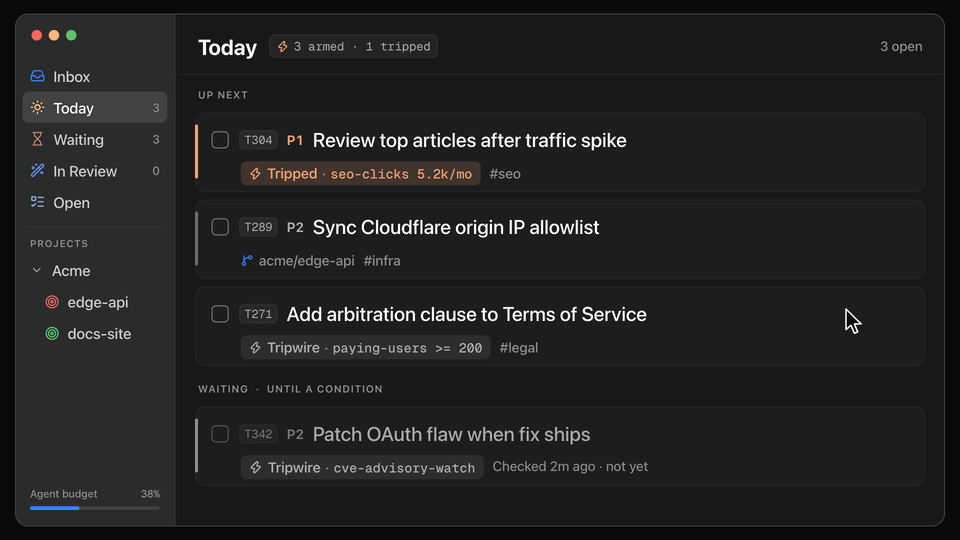

# CXTasks

An agentic task manager for macOS built with Rust, Tauri 2, React 19, and SQLite.

Every task works as a normal to-do item (due dates, recurrence, priorities, reminders, projects), and any task can also carry an execution context — repo path, brief, tripwire, and permission envelope — so it can be filed by an agent mid-session over MCP and later dispatched to **Claude Code** or **Codex**, interactively in Ghostty or unattended in the background.



<sub>App replica with seeded demo data. [Watch the full 40-second overview with sound](https://cxventures.io/products/cxtasks).</sub>

## Why

Session-scoped task lists die when the chat closes, and generic issue trackers don't know how to wake up an agent against a local repo with bounded permissions. CXTasks sits in the middle: a fast, local-first macOS task store with a built-in MCP server, condition tripwires, and a sandboxed background runner.

## What it does

- **MCP capture (`cxtasks-mcp`)** — Claude Code or Codex can file follow-up tasks mid-session with the target repo, a structured brief, priority, and acceptance criteria so nothing gets lost between sessions.
- **Condition tripwires** — Park a task in *Waiting* until a condition holds:
  - **Script**: an executable in the tripwires folder (exit `0` trips with stdout as evidence).
  - **Condition**: a plain-English check evaluated against the task's notes and comments.
  - **Agent**: a read-only Claude check (`Read`, `Glob`, `Grep`) against the repo that surfaces the task in *Today* with its findings once ready.
- **Bounded agent dispatch** — Launch interactively in Ghostty (or Herdr when installed) or delegate unattended to `cxtasks-runner` (Claude Code or Codex) with an explicit access envelope:
  - **Inspect** — read-only
  - **Run** — adds shell access
  - **Build** — edits files, snapshots the repo before launch for one-click rollback, commits only its own changes on the current branch, and never pushes.
- **Daily token budget & kill switch** — Unattended background runs share one daily budget and can be paused globally with a single toggle.
- **Local-first storage & optional self-hosted sync** — Everything lives in a local SQLite + FTS5 database on your Mac. Optional sync replicates to `cxtasks-server` running on your own hardware (Linux-compatible `cxtasks-core`).
- **Alfred integration** — Quick-capture workflow in `integrations/alfred/`.

## Architecture

```
Claude Code / Codex ──stdio──▶ cxtasks-mcp ──┐
macOS App (Tauri 2 + React 19) ──────────────┼──▶ cxtasks-core (Rust + SQLite/FTS5)
Background Queue (cxtasks-runner) ───────────┘          │
                                                        ├──▶ Foreground: Ghostty / Herdr (Claude Code)
                                                        ├──▶ Background: Claude Code or Codex (snapshot + commit)
                                                        └──▶ Optional sync: cxtasks-server (HTTP, Linux/macOS)
```

Workspace layout:

| Path | Role |
|---|---|
| `crates/cxtasks-core` | OS-agnostic Rust core (schema, SQLite/FTS5 store, tripwires, runner logic — compiles cleanly for Linux & macOS) |
| `crates/cxtasks-server` | Headless HTTP server over `cxtasks-core` for self-hosted multi-host / mobile sync |
| `src-tauri/` | Native macOS Tauri 2 shell, `cxtasks-mcp` stdio server, `cxtasks-runner` CLI |
| `src/` | React 19 + TypeScript + Tailwind CSS 4 + Radix UI + Zustand frontend |
| `integrations/` | Alfred quick-capture workflow and Herdr terminal router |
| `claude-plugin/` | Claude Code plugin manifest & skills |

## Get it

Download the latest signed macOS build from [Releases](https://github.com/cxrobx/cxtasks/releases/latest), or build from source below. CXTasks is free for personal use and internal use inside your organization under BSL 1.1.

## Quick Start

Requires macOS 14+, Node.js 20+, and a Rust toolchain (`rustup`).

```bash
source "$HOME/.cargo/env"
npm install
npm run tauri dev                     # Dev mode with hot reload
```

Production build & standalone binaries:

```bash
source "$HOME/.cargo/env"
npm run tauri build                   # macOS .app / .dmg
cargo build --release --bin cxtasks-mcp
cargo build --release --bin cxtasks-runner
```

Run tests:

```bash
source "$HOME/.cargo/env" && cargo test   # Rust workspace tests
npm test                                  # Frontend tests (Vitest)
```

## License

Source-available under the [Business Source License 1.1](LICENSE): free for personal use and internal use within your organization; cannot be sold or offered as a hosted service without a commercial license. Converts to **Apache License 2.0** on **2030-09-30**.
